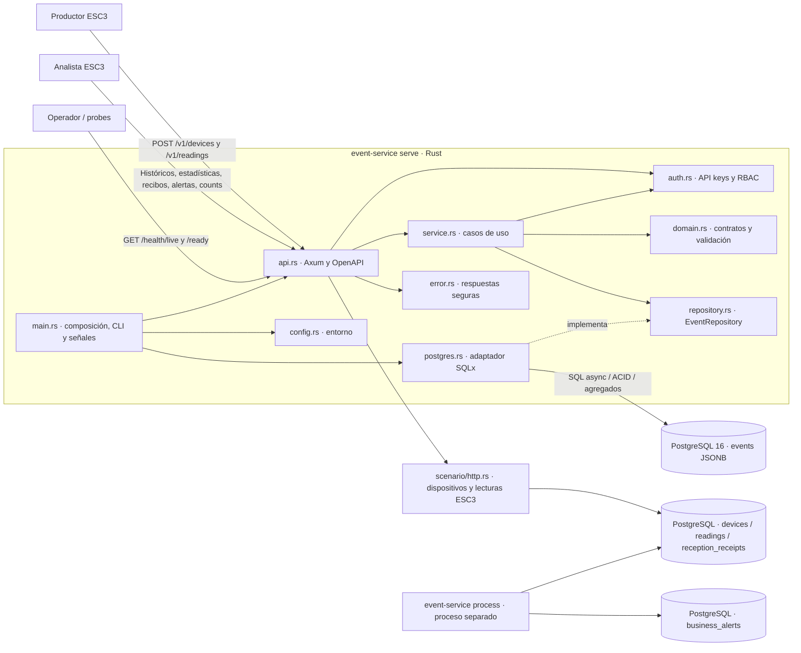

# Contenedores y módulos Rust · COM-02

Tres unidades de ejecución: `event-service serve` (Axum/Tokio), `event-service process` (procesador ESC3) y PostgreSQL 16 con volumen. Comparten binario, no ciclo de vida. El servicio no se divide en microservicios. Diagrama específico y decisiones del inbox en [Escenario 3](../escenario.md).

| Módulo | Responsabilidad |
|---|---|
| `main.rs` | Construye configuración, adaptador y servicio; comandos `serve`, `process`, `drain`, `migrate`, `openapi`, `worker-health`; apagado ordenado |
| `api.rs` | Extracción HTTP, autenticación, rutas, sondas, OpenAPI y correlación; no hace SQL |
| `domain.rs` | Tipos de entrada/salida, enums, UTC y límites verificables |
| `service.rs` | Autoriza todos los casos de uso, valida entradas y deduplica dentro del lote |
| `repository.rs` | Puerto asíncrono intercambiable para persistencia |
| `postgres.rs`, `migrations/` | SQL parametrizado, pool compartido de máximo 10 conexiones, transacciones, snapshots y reintentos |
| `auth.rs` | Claves globales y por fuente; comparación constante de digests SHA-256 |
| `error.rs` | Enum semántico y traducción a JSON seguro |
| `config.rs` | Configuración de inicio sin Debug/Serialize para secretos |
| `scenario/` | `http.rs` autoriza el contrato ESC3; `store.rs` recibe/consulta en API y procesa transaccionalmente en worker; `mod.rs` define tipos y validación |

La API genérica, ESC3 y readiness comparten un único pool de hasta 10 conexiones;
el procesador independiente utiliza otro de hasta 10. Dimensionar PostgreSQL por
**proceso y réplica**, no asumir que toda la plataforma usa 10 conexiones.
Se crean conexiones bajo demanda.

Contratos públicos en [API](../api.md); patrones y límites pragmáticos en [desarrollo](../desarrollo.md).

El camino `service → EventRepository → PostgresRepository` corresponde a
`/v1/events` (compatibilidad). ESC3 usa `scenario::http → scenario::store` y comparte
políticas de `auth`, errores y pool con la API; no es correcto atribuirle el flujo
genérico ni sus respuestas 201/409. La cola es `readings`, no otro servicio.
