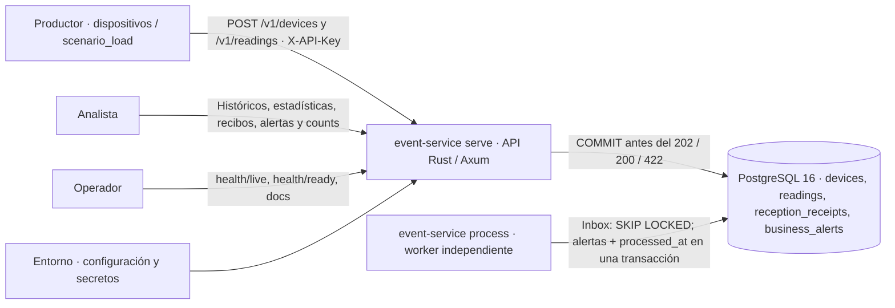

# Contexto · Escenario 3 / COM-02

- **API:** valida y autoriza productores/analistas, guarda lecturas y recibos y permite consultas. No procesa el inbox.
- **Worker:** proceso independiente del mismo binario/imagen; convierte pendientes en procesadas y genera alertas de negocio con límites guardados al recibir. Puede detenerse sin detener la API.
- **PostgreSQL:** fuente de verdad; `devices` posee instalación/límites, `readings` es inbox durable e histórico con unicidad `(device_id,event_id)`, `reception_receipts` registra decisiones y `business_alerts` conserva efectos únicos por lectura/tipo. Analítica SQL solo de procesadas.
- **Entorno:** `Settings` inyectado al inicio; credenciales fuera del repositorio y de imágenes. Configuración de acceso ambigua falla cerrado.
- **Cliente ESC3:** recibe 202 tras COMMIT de lectura nueva, 200 para duplicado válido con el mismo `reading_id`, 422 con recibo durable para validación o 503 si no se puede confirmar persistencia. `X-Request-ID` correlaciona HTTP; los IDs de recibo/lectura correlacionan el dominio.

Hay una **cola lógica transaccional en PostgreSQL**, no un broker externo: 202
significa recepción durable, no procesamiento final. `accepted = processed + pending`;
históricos incluyen pendientes, estadísticas y alertas solo procesadas. Inbox y
recibos sobreviven al reinicio mientras se conserva el disco. No se promete tolerar
la pérdida de la VM ni retención ilimitada segura.

La API genérica `/v1/events` sigue disponible por compatibilidad: usa `events`,
201/409 y unicidad `(source,external_id)`. **No alimenta el inbox ni contadores ESC3**.
Contrato completo: [escenario](../escenario.md), decisión actualizada:
[ADR-0005](../adr/0005-inbox-esc3.md).
