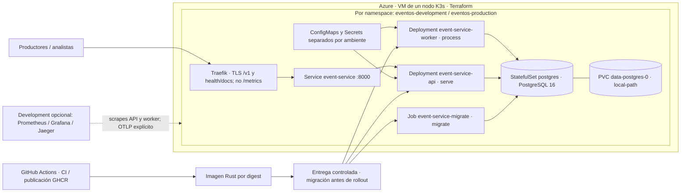

# Despliegue ESC3 · local y Azure/K3s · COM-02

El diagrama describe código y manifiestos versionados, no una inspección en vivo.
[DEV-09](../evidencia/DEV-09/index.md#resultado-en-azure--2026-11-09) documenta
API, worker, PostgreSQL y migración desplegados en development el 2026-11-09,
con digest y smoke. No acredita el estado actual, production ni que cambios
posteriores de observabilidad estén instalados.

## Responsabilidades y límites

- `kubernetes/resources.json` + `scripts/render-k8s.py` definen foundation,
  migration y workloads. API y worker ejecutan la misma imagen por digest, pero
  escalan y reinician de forma independiente. `serve` no migra ni procesa.
- API: probes HTTP `/health/live` y `/health/ready`. Worker: probes exec
  `worker-health live|ready` por heartbeat; no copiarle probes HTTP de la API.
  Su listener HTTP solo expone métricas en 9000.
- PostgreSQL no se publica a Internet. PVC con Retain conserva datos al recrear
  Pods, **no al perder el disco/VM**. Un nodo, sin HA; consultar
  [infraestructura](../infra/README.md) antes de cambiar cloud-init/K3s.
- Secrets y roles de DB distintos para migración y runtime. API/worker sin token
  Kubernetes montado; NetworkPolicy deniega salvo flujos permitidos. Separación
  development/production lógica, no física; datos y credenciales independientes.
- El Ingress público del renderer es solo de production; la flecha a Services
  no implica que development esté publicado. Acceso operativo a development por
  mecanismos autorizados (por ejemplo, port-forward), no abriendo la DB.
- `kubernetes/observability/` contiene los manifiestos adicionales. Jaeger y su
  ConfigMap OTLP opcional son de development; no se infiere exportación desde
  production ni instalación de un Collector separado. Verificar reglas, scrape,
  red y trazas en el entorno, no solo la existencia de YAML.

## Ejecución local

Seguir [README](../../README.md#arranque-local): exportar el entorno, disponer de
PostgreSQL 16, ejecutar `cargo run --locked -- migrate`, después `serve` y `process`
en terminales separadas. API nativa escucha en loopback por defecto. En Compose,
usar el perfil `app` según README y lanzar el procesador por separado; levantar
solo la API no drena pendientes. No cargar `.env` implícitamente.

La imagen distroless ejecuta como UID 10001, sin shell/toolchain. El host usa el
puerto publicado de DB; los contenedores usan `postgres:5432`. Antes de una entrega,
seguir [Kubernetes](../../kubernetes/README.md) para migración explícita,
aprobaciones, digest, probes y smoke.

## Contraste con recursos observados

La evidencia DEV-09 acredita un despliegue histórico de development. Para acreditar
una revisión nueva, registrar fecha, namespace, commit/digest, `imageID` de API,
worker y Job, réplicas/probes, PVC y una lectura recibida/procesada. Production y la
observabilidad deben contrastarse por separado. Este cambio documental no ejecuta
`apply`, no reinicia componentes y no presenta un plan como despliegue aprobado.
