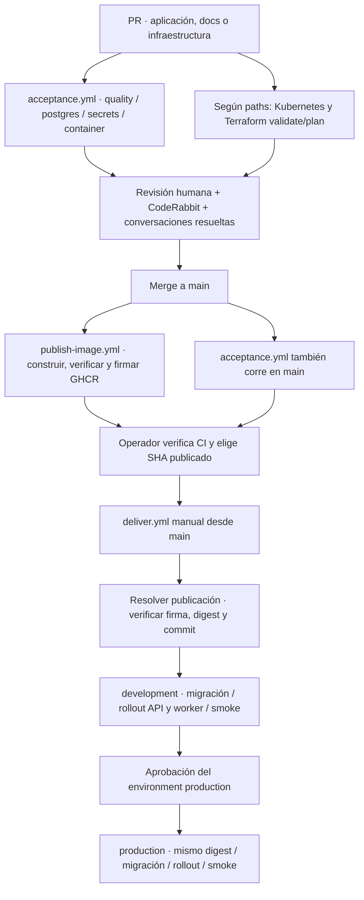

# Flujo DevOps · de un PR a Azure/K3s

Guía contrastada con **main `eb8fa8f`** y los siete workflows de
`.github/workflows/`. Describe automatización existente, no una ejecución nueva.
La configuración de GitHub (protecciones y environments) se comprobó por API al
preparar esta guía; no vive íntegramente en Git y puede cambiar.



## 1. Preparar y revisar el cambio

1. Crear una rama desde main, un PR por issue y usar la
   [plantilla](../.github/pull_request_template.md). `Closes #N` solo si cumple
   todo su alcance; `Refs #N` si es parcial. Evidencia en `docs/evidencia/<ID>/`.
2. Ejecutar `npm ci` (Node.js ≥18) para instalar Husky. El pre-commit comprueba
   **solo formato Rust**; no sustituye CI ni autoriza saltarse tests.
3. Ejecutar verificaciones según los archivos modificados. Solicitar CodeRabbit
   y revisión humana. Un check `neutral`/`skipped` por cuota o configuración no
   cuenta como revisión efectiva; pedir `@coderabbitai review` si se omite.
4. Consultar los resultados del **último SHA**, no los de un commit anterior.

La protección de main comprobada exige `quality`, `postgres`, `container` y
`secrets`, estar actualizado con la base, una aprobación de codeowner y resolver
conversaciones; descarta aprobaciones obsoletas. Los codeowners actuales están en
[CODEOWNERS](../.github/CODEOWNERS). Write permite revisar PR ajenos y lanzar
workflows; no permite autoaprobar el propio PR. CodeRabbit es una revisión
adicional requerida por el proceso del repo, no uno de esos cuatro checks de
aplicación. No usar un bypass administrativo para sustituir estos controles.

## 2. Qué valida cada workflow

| Archivo / nombre | Cuándo se activa | Qué hace y qué no hace |
|---|---|---|
| [`acceptance.yml`](../.github/workflows/acceptance.yml) · Rust quality and acceptance | Todo PR y push a main, sin filtro de paths | Cuatro jobs de aplicación; **no publica ni despliega**. Nuevas ejecuciones de la misma ref cancelan las anteriores |
| [`kubernetes.yml`](../.github/workflows/kubernetes.yml) · Kubernetes manifests | PR y push a main cuando cambian manifiestos, renderer o scripts incluidos en su filtro; el evento PR no restringe rama base | Contratos offline, sintaxis shell, kubeconform 1.35 y prueba local de init/permisos PostgreSQL. No aplica al clúster |
| [`publish-image.yml`](../.github/workflows/publish-image.yml) · Publicar imagen | Push a main y tags `v*.*.*` | Publica GHCR por SHA/semver, verifica imagen y firma procedencia; no entrega a K3s |
| [`deliver.yml`](../.github/workflows/deliver.yml) · Entrega controlada | Manual (`workflow_dispatch`), solo ref main | Promueve un SHA de main publicado por evento push; development → smoke → aprobación → production, sin reconstruir |
| [`terraform.yml`](../.github/workflows/terraform.yml) · Terraform | PR a main con `infra/**`; push a main con `infra/terraform/**`, `infra/ssh/**` o el propio workflow; también manual | Validación, plan especulativo en PR elegible o apply protegido fuera de PR. No despliega la imagen de aplicación |
| [`terraform-drift.yml`](../.github/workflows/terraform-drift.yml) · Drift de Terraform | Diario `0 14 * * *` UTC y manual | Plan con identidad de lectura y lock; **nunca aplica**. Código 0: sin diferencias; 2: drift y job fallido; otro: error de plan |
| [`vm-power.yml`](../.github/workflows/vm-power.yml) · Energía de la VM | Diario `0 5 * * *` UTC y manual `status/start/stop` | Desasigna a las 23:00 de El Salvador; no despliega ni destruye datos. `start` enciende la VM para una entrega autorizada |

### Los cuatro checks de aplicación

- **quality:** pruebas Python de scripts, `cargo fmt`, Clippy estricto, all-targets,
  rustdoc con `-D warnings` y OpenAPI generado sin DB. Publica
  `rust-api-and-code-docs` (OpenAPI + rustdoc).
- **postgres:** PostgreSQL 16 dedicado; migración explícita, targets `postgres`
  **y `metrics` con `--ignored`**, y `verify_system` con procesos/contenedor propios.
  Publica `rust-postgres-evidence`. Que all-targets omita los ignored no acredita
  aceptación PostgreSQL; faltar DB en la ejecución explícita debe fallar.
- **secrets:** escaneo del historial completo con `scripts/scan-secrets.sh`.
- **container:** build de imagen no-root y `scripts/verify-image.sh`; hardening,
  escaneo/SBOM y artefacto `container-security-evidence`. No publica esa imagen.

## 3. Publicar no equivale a aprobar ni desplegar

Publicación y CI de main se disparan **en paralelo**, sin dependencia entre esos
workflows. El operador debe comprobar los cuatro checks del SHA antes de entregar;
`deliver.yml` no vuelve a validar automáticamente sus conclusiones de CI.

Publicar imagen construye, descarga y verifica los bytes publicados, comprueba la
etiqueta OCI de revisión, genera SBOM/provenance y attestation verificable. Guarda
`image-publication-<SHA>` por 90 días, con `publicacion.json`, digest, tags y run.
No existe tag `latest`; `sha-<corto>` es una referencia legible, **el digest es la
referencia de despliegue**. Un artefacto expirado puede impedir resolver la entrega.

## 4. Entrega controlada

Prerrequisitos: foundation, Secrets, DB, roles, ServiceAccount de despliegue e
Ingress ya preparados mediante el [procedimiento Kubernetes](../kubernetes/README.md);
VM encendida, capacidad suficiente y credenciales federadas/variables configuradas.
No recrear foundation, volúmenes ni contraseñas para actualizar la aplicación.

En una ventana autorizada, sin copiar valores secretos:

```bash
git fetch origin
COMMIT=$(git rev-parse origin/main)
# Inspeccionar CI/publicación del SHA; no basta un check neutral de CodeRabbit.
gh run list --workflow acceptance.yml --commit "$COMMIT" --event push
gh run list --workflow publish-image.yml --commit "$COMMIT" --event push
# Comprobar la VM; esperar el resultado del workflow antes de continuar.
gh workflow run vm-power.yml --ref main -f action=status
# Si está desasignada y se autorizó su uso, encender y esperar a que termine:
# gh workflow run vm-power.yml --ref main -f action=start
gh workflow run deliver.yml --ref main -f commit="$COMMIT"
```

**No ejecutar la última línea hasta confirmar CI, publicación y VM.**
El SHA debe tener 40 caracteres y pertenecer a main. La referencia del workflow
también debe ser main; una publicación de tag no sustituye la publicación push
del SHA exigida por el resolver.

1. **resolve:** busca por SHA/evento y selecciona una publicación con conclusión
   `success`; descarga su artefacto. Verifica attestation, workflow firmante y SHA
   firmado antes de entregar la imagen inmutable.
2. **development:** autentica en Azure por OIDC, comprueba VM running y usa Azure
   Run Command para ejecutar el bundle. Antes del rollout espera PostgreSQL Ready
   y aplica el Job de migración del mismo digest con la identidad DDL.
3. **rollout y smoke:** aplica workloads API/worker con el ServiceAccount de
   despliegue limitado, espera ambos rollouts y verifica `imageID` por digest.
   El smoke debe aceptar y comprobar **la lectura exacta** procesada por el worker;
   `rollout status` por sí solo no prueba procesamiento.
4. **production:** requiere éxito de development y la aprobación normal del
   environment. Usa el **mismo digest** y repite migración, rollout y smoke.
5. **resultado:** comprobar `ENTREGA_OK` para cada ambiente, conclusión del workflow,
   commit y digest. Run Command puede devolver éxito aunque el script falle: por
   eso la acción verifica la marca final, no solo la respuesta de Azure.

Esta entrega actualiza `event-service-api` y `event-service-worker`, con migración
previa. **No actualiza PostgreSQL, Terraform, foundation, Ingress ni instala la
observabilidad**. Esas capas tienen procedimientos separados. API y worker
consumen un ConfigMap OTLP opcional; una entrega no acredita que Jaeger/Prometheus,
dashboard o alertas estén operativos ni que production exporte a development.

### Environments y autorizaciones

| Environment | Uso | Protección comprobada |
|---|---|---|
| development | Entrega y smoke inicial | Solo main; sin revisión requerida |
| production | Promoción de aplicación | Solo main; revisor requerido; bypass de administradores deshabilitado; auto-revisión del actor permitida por la configuración actual |
| azure-infra | Job apply de Terraform | Solo main; revisor requerido; auto-revisión del actor prohibida |
| azure-ops | VM y plan de drift | Solo main; sin revisión requerida |

Los revisores configurados de production/azure-infra son Marcelo, Sushiland123,
ValeriaCastro20 y CristiRR (identificadores en [CODEOWNERS](../.github/CODEOWNERS)).
No confundir la aprobación de un environment con la revisión de un PR. La opción
de bypass administrativo de azure-infra existente no se debe usar para evitar
su aprobación. Credenciales OIDC, permisos y estado remoto:
[infraestructura](infra/README.md). No publicar tokens, kubeconfig o Secrets.

## 5. Fallos y rollback

| Síntoma | Comprobación / respuesta |
|---|---|
| Workflow queued sin jobs | No hay tests ejecutados ni logs de job. Consultar Actions; no atribuirlo a cuota/runners sin evidencia ni confundirlo con CodeRabbit |
| resolve no encuentra publicación | Revisar SHA, evento push, conclusión y artefacto; no sustituir por un tag flotante ni omitir attestation |
| VM deallocated | Encendido autorizado con vm-power; esperar antes de reintentar |
| Migración fallida | No se actualizan workloads; diagnosticar Job/esquema. No editar SQL aplicada ni borrar Jobs para esconder el fallo |
| Rollout/smoke fallido | El script restaura templates previos de los Deployments que cambió y verifica su digest/smoke; si no existían, no hay versión previa que restaurar |
| ROLLBACK_FALLÓ | Estado no recuperado: intervención del operador; no afirmar recuperación por ejecutar un undo |

Rollback manual autorizado desde la VM o una sesión Kubernetes configurada:

```bash
# Sin imagen, lista revisiones y termina con código 2; no modifica workloads.
KUBECTL='sudo k3s kubectl' bash scripts/k8s-rollback.sh production
# Con un digest sano comprobado, restaura revisiones retenidas y ejecuta smoke:
# KUBECTL='sudo k3s kubectl' bash scripts/k8s-rollback.sh production "$IMAGE_SANA"
```

Rollback de Deployment **no revierte migraciones ni restaura datos**. Requiere
compatibilidad del esquema; no sustituye backup/restore. Ver
[DEV-12](evidencia/DEV-12/index.md) y [runbook](operaciones.md).

## 6. Terraform, acceso y drift

`terraform.yml` valida con backend deshabilitado y TFLint. PRs internos elegibles
generan plan especulativo con identidad de plan; forks o falta de configuración
reciben un aviso de plan omitido, **no un plan aprobado**. El plan PR no se aplica.

En push elegible o lanzamiento manual desde main, `azure-infra` protege el job
apply. **La aprobación habilita el job**, que luego genera un plan guardado y
aplica ese plan; no implica que el revisor haya visto de antemano ese nuevo plan.
Revisar cambios y plan de PR y comprobar la salida final. Cambiar cloud-init/K3s
puede reemplazar VM y perder discos `local-path`: no aplicar para probar documentación.

Para acceso SSH: PR de una clave **pública** en `infra/ssh/*.pub`, ajuste autorizado
del secret `INFRA_ADMIN_CIDRS` fuera de Git y apply aprobado. El secret no modifica
Azure inmediatamente: hasta reconciliar, el plan de drift puede mostrar diferencias.
Nunca versionar IPs administrativas, claves privadas, state ni tfvars reales.
El plan de drift no corrige nada por sí solo y mantiene el locking del state.

## 7. Evidencia y límite de las afirmaciones

Guardar SHA, CI, publicación, digest, entrega, aprobador y resultado por ambiente;
no una captura verde sin identificar versión. Ejemplo histórico verificable:
[entrega 43114911744, intento 2](https://github.com/marchelo23/Proyecto-Final-Metricas-y-DevOps/actions/runs/43114911744)
de main `84e43ab`: firma, development y production exitosos. No acredita que el
último main `eb8fa8f` esté desplegado ni demuestra MET-07 o dashboards.

Desasignar la VM cuando termine su uso autorizado; disco/IP pueden seguir cobrando.
Límite **US$100 acumulados**, no solo mensuales: [costos](infra/costos.md).
Reconstrucción desde suscripción autorizada: [infraestructura](infra/README.md),
[Kubernetes](../kubernetes/README.md) y las configuraciones de observabilidad
versionadas. Las limitaciones y verificaciones pendientes no se cierran por
documentar este flujo.
