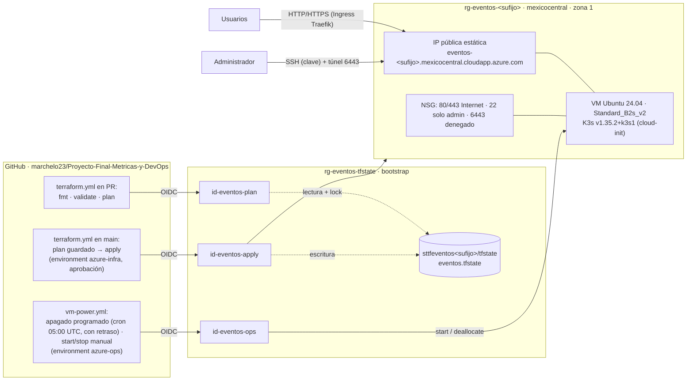

# Infraestructura en Azure · DEV-06, DEV-07, DEV-08, DEV-13

La plataforma corre en **un clúster K3s de un solo nodo** sobre una VM de Azure creada con Terraform. Development y production se separan **lógicamente** con namespaces dentro del mismo clúster (condición 5.4 del proyecto). Este documento cubre la infraestructura de Azure; los manifiestos de Kubernetes, la publicación de imágenes y la entrega continua pertenecen a DEV-02…05 y DEV-09…12. Costos y apagado: [costos.md](costos.md) (DEV-14).

Manifiestos de aplicación y orden de migración/rollout para revisión: [`kubernetes/README.md`](../../kubernetes/README.md). Su existencia no acredita despliegue en este clúster; la evidencia pendiente se registra en [DEV-09](../evidencia/DEV-09/index.md).

## Arquitectura



| Recurso (Terraform) | Nombre | Propósito |
|---|---|---|
| Resource Group | `rg-eventos-<sufijo>` | Contenedor de la plataforma |
| VNet / subred | `vnet-eventos-<sufijo>` · `snet-k3s` (10.40.1.0/24) | Red privada de la VM |
| NSG | `nsg-eventos-<sufijo>-k3s` | 80/443 desde Internet, 22 solo desde `admin_cidrs`, 6443 denegado |
| IP pública | `pip-eventos-<sufijo>-k3s` | Estática, Standard, con etiqueta DNS `eventos-<sufijo>` |
| VM | `vm-eventos-<sufijo>-k3s` | Ubuntu 24.04, `Standard_B2s_v2` (2 vCPU, 8 GB), zona 1, disco StandardSSD de 64 GB |
| Presupuesto | `budget-eventos-<sufijo>` | US$100 mensuales a nivel de suscripción; alertas al 50 % y 80 % reales y al 100 % pronosticado |
| Extensión de la VM | `team-ssh-keys` (CustomScript) | `authorized_keys` de `azureuser` con la clave del administrador y las de [`infra/ssh/*.pub`](../../infra/ssh/README.md) |

El bootstrap crea, fuera de Terraform, el Resource Group `rg-eventos-tfstate` con el Storage del state y las tres identidades de GitHub Actions.

### Decisiones

- **`mexicocentral`, `Standard_B2s_v2`, zona 1.** Es la configuración validada en la clase *Integración de infraestructura, Kubernetes y despliegue de aplicaciones* y en la plantilla [`k8s-azure-template`](https://github.com/guillermocalderon2021/k8s-azure-template). En esta suscripción, `Standard_B2s_v2` está restringido en la **zona 2** de `mexicocentral` (`NotAvailableForSubscription`, tipo `Zone`). Un primer intento en `westus` falló por capacidad (`SkuNotAvailable`) en B2as_v2, B2s_v2, B2ms, D2s_v4 y D2as_v4, y por cuota 0 en D2as_v5. Siguiendo la indicación del docente, región, tamaño y zona no se cambian sin verificar restricciones (`az vm list-skus`), cuotas (`az vm list-usage`) y capacidad. La política de la suscripción solo permite `westus`, `northcentralus`, `westus3`, `mexicocentral` y `canadacentral`.
- **AzureRM `4.40.0` fijo.** Es la versión que validó el docente. Su README registra que la API de red `2025-01-01` devolvió `404` para recursos recién creados en `mexicocentral`. Con AzureRM 5.13 ocurrió lo mismo con la VNet (ver *Incidentes*). El cambio de 5.13 a 4.40.0 se verificó con un plan sin diferencias sobre el state existente.
- **2 vCPU y 8 GB.** El nodo aloja K3s, la API en dos namespaces, PostgreSQL y la observabilidad (Prometheus, Grafana, OpenTelemetry Collector, visor de trazas). Recién instalado, K3s usa unos 1.1 GiB.
- **Un nodo, sin HA.** El proyecto no exige alta disponibilidad ni tolerancia a la pérdida de la VM. Un reinicio de Pod no equivale a perder la VM.
- **K3s por cloud-init, con reintentos.** Versión fija `v1.35.2+k3s1`, la misma de la clase. `/usr/local/sbin/k3s-bootstrap.sh` reintenta la instalación hasta 10 veces y espera como máximo 10 minutos a que el nodo esté `Ready`. Si falla, cloud-init termina en `error` en vez de quedarse esperando. El registro queda en `/var/log/k3s-bootstrap.log`. Cambiar la versión o el template **reemplaza la VM** (y los volúmenes `local-path`); el plan lo muestra antes de aplicar. El instalador se descarga por HTTPS desde `get.k3s.io`, como en la plantilla del docente, y verifica el SHA256 del binario contra los checksums de la release. Pendiente para el próximo reemplazo planificado de la VM: fijar `install.sh` a la etiqueta de la versión y comprobar su checksum. Hacerlo ahora obligaría a reemplazar la VM sin otra necesidad.
- **Apagado diario con GitHub Actions.** `Microsoft.DevTestLab/schedules`, el apagado automático de Azure, no existe en `mexicocentral` (`LocationNotAvailableForResourceType`) y no se puede crear en otra región (`InvalidScheduleLocation`). El workflow [`vm-power.yml`](../../.github/workflows/vm-power.yml) desasigna la VM con un cron de 05:00 UTC (23:00 en El Salvador). GitHub no garantiza la hora de los cron: del 9 al 12 de noviembre corrió con 7 a 9 h de retraso, y una corrida falló al iniciar ([DEV-14](../evidencia/DEV-14/index.md#actualización--2026-11-12)). Por eso no se puede tratar como apagado puntual: al terminar de trabajar se apaga a mano. También permite a cualquier integrante encenderla o apagarla sin credenciales de Azure.
- **API de Kubernetes cerrada.** El puerto 6443 no se publica. La administración se hace por SSH con clave (sin contraseña) y un túnel: `ssh -N -L 6443:127.0.0.1:6443 azureuser@<fqdn>`.
- **DNS y TLS.** La IP tiene una etiqueta DNS de Azure (`<label>.mexicocentral.cloudapp.azure.com`), que sirve de nombre para el Ingress y para el certificado TLS que emita el clúster.
- **Sin registro automático de resource providers** (`resource_provider_registrations = "none"`). La identidad de plan es Reader y no podría registrarlos; el bootstrap registra los que se usan.

## Estado remoto · DEV-07

| Elemento | Valor |
|---|---|
| Resource Group | `rg-eventos-tfstate` (creado por el bootstrap, fuera de Terraform) |
| Storage Account | `sttfeventos<sufijo>`, StorageV2, TLS 1.2, HTTPS, **sin acceso por access key** ni acceso público |
| Container / key | `tfstate` / `eventos.tfstate` |
| Autenticación | Microsoft Entra ID (`use_azuread_auth = true`) |
| Protección | Versionado de blobs y retención de borrado de 14 días (blobs y containers) |
| Locking | Lease del blob durante `plan` y `apply` |

Identidades y accesos:

| Principal | Rol | Alcance | Uso |
|---|---|---|---|
| Usuario que ejecuta el bootstrap | Storage Blob Data Contributor | Storage del state | Terraform local |
| `id-eventos-plan` | Reader · Storage Blob Data Contributor | Suscripción · Storage del state | Plans en PR (subject `pull_request`) y drift programado (subject `environment:azure-ops`) |
| `id-eventos-apply` | Contributor · Storage Blob Data Contributor | Suscripción · Storage del state | Apply desde `main` (subject `environment:azure-infra`) |
| `id-eventos-ops` | `eventos-<sufijo>-vm-operator` (personalizado: leer, encender y desasignar VMs) | Suscripción | `vm-power.yml` (subject `environment:azure-ops`); sin acceso al state |

El state nunca se versiona y no se abre ni se publica. Si se pierde, la infraestructura sigue existiendo, pero Terraform deja de saber qué administra; el versionado permite recuperar la versión anterior del blob.

### Bloqueo y recuperación

- **Bloqueo.** Terraform toma un *lease* del blob durante `plan` y `apply`. Una segunda ejecución espera (`-lock-timeout`) o falla con `state blob is already locked`. Los workflows, además, serializan sus ejecuciones con `concurrency`.
- **Lock que quedó tomado.** Un corte de red puede dejar el lease tomado (ocurrió el 2026-11-08). Primero hay que confirmar que no hay ninguna ejecución en curso, ni en Actions ni en equipos locales. Después se libera:
  - si el error muestra un ID: `terraform force-unlock <ID>`;
  - si el lock no tiene metadatos: `az storage blob lease break --account-name sttfeventos<sufijo> -c tfstate -b eventos.tfstate --auth-mode login`.

  Nunca usar `-lock=false`.
- **Recuperación ante corrupción o un apply erróneo.** Cada escritura del blob crea una versión. Para volver a una anterior:

  ```bash
  az storage blob list --account-name sttfeventos<sufijo> -c tfstate --include v --auth-mode login \
    --query "[?name=='eventos.tfstate'].{version:versionId, actual:isCurrentVersion}" -o table
  az storage blob download --account-name sttfeventos<sufijo> -c tfstate -n eventos.tfstate \
    --version-id <versionId> -f recuperado.tfstate --auth-mode login
  # Revisar serial, lineage y recursos. Con el equipo de acuerdo y sin ejecuciones en curso:
  terraform state push -force recuperado.tfstate
  terraform plan    # muestra la diferencia entre ese state y Azure
  ```

  El simulacro del 2026-11-08 descargó versiones anteriores y comprobó que conservan el mismo `lineage` con un `serial` menor; no se sobrescribió el state real (evidencia en DEV-07). En Windows, `az ... -o tsv` deja un `\r` al final del `versionId`: hay que quitarlo antes de usarlo.
- **Red.** El Storage acepta conexiones públicas porque los runners de GitHub no tienen IP fija. La protección es de identidad: sin access keys, solo Entra ID con RBAC, y TLS 1.2.

## Terraform en GitHub Actions · DEV-08

Workflow [`terraform.yml`](../../.github/workflows/terraform.yml):

| Evento | Jobs | Identidad |
|---|---|---|
| PR que toca `infra/**` | `fmt -check`, `validate`, `tflint` y **speculative plan**, publicado en el resumen y como artefacto `terraform-plan-pr-<n>` | `id-eventos-plan` |
| PR desde un fork | Solo `fmt`, `validate` y `tflint`; el plan se omite con un aviso (los forks no reciben token OIDC) | — |
| Push a `main` con cambios en `infra/terraform/**`, o ejecución manual **desde `main`** | `plan -out=tfplan` y `apply tfplan`, **después de la aprobación** del environment `azure-infra` | `id-eventos-apply` |
| Diario a las 08:00 ([`terraform-drift.yml`](../../.github/workflows/terraform-drift.yml)) | `plan -detailed-exitcode` sin aplicar: el job falla si Azure difiere del código | `id-eventos-plan` |

Ningún PR ni otra rama aplica cambios. El job exige `github.ref == 'refs/heads/main'`, también con `workflow_dispatch`, y el environment `azure-infra` solo admite `main`. El apply solo ocurre con código integrado y aprobado, y aplica exactamente el plan guardado. La región, el tamaño y la zona viven en el código (`variables.tf`): cambiarlos exige un PR con su plan.

### Configuración del repositorio (una vez, la hace un administrador)

1. **Settings → Environments:**
   - `azure-infra` → *Required reviewers* (al menos un integrante distinto de quien hizo el cambio) y *Deployment branches and tags*: solo `main`. Crearlo así **antes** de definir `APPLY_CLIENT_ID`.
   - `azure-ops` → *Deployment branches and tags*: solo `main`. Sin revisores, para que el apagado y el drift programados no esperen aprobación. Sus dos identidades no pueden crear ni modificar recursos.
2. **Settings → Secrets and variables → Actions:**

| Tipo | Nombre | Origen |
|---|---|---|
| Variable | `AZURE_SUBSCRIPTION_ID`, `AZURE_TENANT_ID` | `infra/bootstrap/bootstrap.env` |
| Variable | `PLAN_CLIENT_ID`, `APPLY_CLIENT_ID`, `OPS_CLIENT_ID` | `infra/bootstrap/bootstrap.env` |
| Variable | `INFRA_NAME_SUFFIX` | `infra/bootstrap/bootstrap.env` |
| Variable | `INFRA_ADMIN_SSH_PUBLIC_KEY` | Clave pública SSH del administrador |
| **Secret** | `INFRA_ADMIN_CIDRS` | Lista HCL, por ejemplo `["203.0.113.10/32"]` |
| **Secret** | `INFRA_BUDGET_CONTACT_EMAILS` | Lista HCL, por ejemplo `["integrante@esen.edu.sv"]` |

No hay credenciales: el acceso a Azure usa OIDC. La IP de administración y los correos se guardan como *secrets* solo por privacidad. El repositorio es público, y las *variables* aparecen en texto plano en los logs de Actions. Además, Terraform las declara `sensitive`, así que tampoco aparecen en los planes ni en el artefacto del plan.

## Acceso del equipo

Los integrantes que administran el clúster entran como `azureuser` con su propia clave:

- **Clave:** cada integrante tiene un archivo `infra/ssh/<nombre>.pub` en el repositorio, agregado por PR. Terraform escribe `authorized_keys` con exactamente esas claves y la del administrador.
- **IP:** su `/32` va en el secret `INFRA_ADMIN_CIDRS` y en el `terraform.tfvars` local del administrador; no se publica en el repositorio.
- **VM encendida:** Azure solo cambia la extensión de claves con la VM en marcha, así que hay que encenderla antes de aprobar el apply.

Procedimiento completo en [`infra/ssh/README.md`](../../infra/ssh/README.md).

| Integrante | Desde | Bloque |
|---|---|---|
| Leonardo (administrador, `admin_ssh_key`) | 2026-11-08 | B |
| Valeria (`infra/ssh/valeria.pub`) | 2026-11-08 | C |

Dentro de la VM se usa `sudo k3s kubectl`, como en la clase. Para `kubectl` local, `SSH_KEY=~/.ssh/<clave> bash infra/scripts/kube-access.sh` y el túnel que indica. La API 6443 sigue cerrada a Internet.

`kube-access.sh` lee el FQDN con `terraform output`, lo que exige el backend inicializado y acceso al state en Azure. Un integrante sin rol en Azure pasa el nombre directamente: `FQDN=eventos-<sufijo>.mexicocentral.cloudapp.azure.com SSH_KEY=~/.ssh/<clave> bash infra/scripts/kube-access.sh`. Para quitar un acceso, ver [*Quitar el acceso*](../../infra/ssh/README.md#quitar-el-acceso): el apply no corta sesiones abiertas ni invalida un kubeconfig copiado.

## Reconstrucción desde cero · DEV-13

Prerrequisitos: Azure CLI con sesión de un **Owner** de la suscripción (`az login`), GitHub CLI (`gh auth login`), Terraform ≥ 1.12, Git Bash o Linux, `openssl` y un par de claves SSH. En Windows con Git Bash, los scripts ya exportan `MSYS_NO_PATHCONV=1`.

1. **Bootstrap** (único paso fuera de Terraform; crea identidades y RBAC, por eso lo ejecuta un Owner):

   ```bash
   bash infra/bootstrap/bootstrap.sh
   ```

2. Confirmar que `infra/terraform/backend.hcl` tenga el `storage_account_name` que imprimió el bootstrap.
3. Crear `infra/terraform/terraform.tfvars` a partir de `terraform.tfvars.example` con los valores de `infra/bootstrap/bootstrap.env`, la clave pública SSH, la IP de administración (`curl -4 https://api.ipify.org`) y los correos del presupuesto.
4. Aplicar, revisando el plan antes de confirmar:

   ```bash
   cd infra/terraform
   export ARM_USE_CLI=true
   terraform init -backend-config=backend.hcl
   terraform plan -out=tfplan
   terraform apply tfplan
   ```

5. Verificar el ambiente, unos 5 minutos después del apply para que cloud-init instale K3s:

   ```bash
   SSH_KEY=~/.ssh/<clave> bash infra/scripts/verify.sh
   ```

   El script compara la huella SSH del servidor con la que reporta Azure **antes** de conectarse, como pide la clase, y no acepta huellas a ciegas. Luego comprueba en orden:
   - que cloud-init está en `done` y el nodo K3s en `Ready`;
   - que los Pods del sistema están en `Running` o `Completed`;
   - que el HTTP público responde;
   - que la API 6443 está cerrada desde Internet;
   - que SSH solo acepta clave.

   Termina con `Ambiente verificado.` o con la lista de fallas. La verificación manual equivalente:

   ```bash
   bash infra/scripts/vm.sh fingerprint        # comparar con la huella que muestra ssh
   ssh -i ~/.ssh/<clave> azureuser@$(terraform output -raw public_fqdn)
   sudo cloud-init status --wait            # done
   sudo k3s kubectl get nodes -o wide       # nodo Ready
   sudo k3s kubectl get pods -A             # CoreDNS, Traefik, local-path, metrics-server
   ```

6. Para administrar desde el equipo local: `SSH_KEY=~/.ssh/<clave> bash infra/scripts/kube-access.sh`. Luego abrir el túnel que indica y usar `KUBECONFIG=./kubeconfig kubectl get nodes`.
7. Configurar el repositorio (sección anterior) para que los cambios siguientes pasen por los workflows.

| Paso | Tiempo aproximado | Costo |
|---|---|---|
| Bootstrap | 3–5 min | Storage del state: centavos al mes |
| `terraform apply` | 3–4 min | Desde aquí corren la VM, el disco y la IP: ≈ US$1.30/día con 12 h encendida |
| cloud-init y K3s | 3–5 min después del apply | — |
| `verify.sh` | 1 min | — |

Todos los pasos son reintentables. El bootstrap es idempotente, `terraform apply` retoma lo que falte y `k3s-bootstrap.sh` se puede volver a ejecutar en la VM.

Intervenciones manuales declaradas:

- el bootstrap: identidades, rol personalizado, credenciales federadas y backend (se deshace con [`teardown.sh`](../../infra/bootstrap/teardown.sh));
- la configuración de los environments y las variables de GitHub;
- la creación del par de claves SSH.

Todo lo demás lo crea Terraform.

Si algo falla:

| Síntoma | Qué hacer |
|---|---|
| `Provider produced inconsistent result after apply … Root object was present, but now absent` | El recurso **sí** se creó, pero Azure respondió `404` al leerlo. Confirmar que existe (`az resource list -g <rg>`), importarlo con `terraform import <dirección> <id>` y volver a planificar. No borrarlo a mano. |
| `SkuNotAvailable` o restricción de zona | No cambiar región ni tamaño al azar: revisar `az vm list-skus --location mexicocentral --size Standard_B2s_v2` y documentar la alternativa elegida. |
| `cloud-init status` en `error` o nodo sin `Ready` | Revisar `/var/log/k3s-bootstrap.log`. El script se puede volver a ejecutar: `sudo /usr/local/sbin/k3s-bootstrap.sh`. |
| SSH expira | La IP pública de origen cambió: actualizar `admin_cidrs` y aplicar. La regla tarda un par de minutos en surtir efecto. |

## Operación y eliminación

```bash
bash infra/scripts/vm.sh status       # estado de energía
bash infra/scripts/vm.sh start        # antes de trabajar, de una demostración o de la defensa
bash infra/scripts/vm.sh stop         # desasigna: deja de cobrarse el cómputo
bash infra/scripts/vm.sh fingerprint  # huella SSH del servidor
SSH_KEY=~/.ssh/<clave> bash infra/scripts/verify.sh   # verificación completa
```

Sin acceso a Azure: **Actions → Energía de la VM → Run workflow** con `start`, `stop` o `status`. El mismo workflow desasigna la VM una vez al día con un cron de 05:00 UTC, pero GitHub lo ejecuta con horas de retraso: apagarla a mano al terminar. La IP pública es estática y K3s arranca solo: después de encender la VM, el clúster vuelve a `Ready` en uno o dos minutos.

Eliminar la plataforma (los datos de los volúmenes del clúster se pierden):

```bash
cd infra/terraform && ARM_USE_CLI=true terraform plan -destroy   # revisar
ARM_USE_CLI=true terraform destroy
az group exists --name rg-eventos-<sufijo>                       # false
bash ../bootstrap/teardown.sh      # solo al cerrar el proyecto: elimina el state, las identidades y sus permisos
```

`teardown.sh` elimina también las asignaciones de rol en la suscripción y el rol personalizado. Borrar solo `rg-eventos-tfstate` las dejaría huérfanas. Pide escribir el sufijo para confirmar y se detiene sin borrar nada en tres casos: si la sesión de `az` está en otra suscripción, si la plataforma aún existe o si el Resource Group contiene el state de otro bootstrap.

Simulacro de reconstrucción desde cero por otro integrante, en su propia suscripción: [simulacro-reconstruccion.md](simulacro-reconstruccion.md).

## Incidentes registrados

| Fecha | Síntoma | Causa | Resolución |
|---|---|---|---|
| 2026-11-08 | VM rechazada en `westus` (`SkuNotAvailable`) en cinco tamaños | Falta de capacidad de Azure en la región | Se adoptó la configuración validada por el docente: `mexicocentral`, `Standard_B2s_v2`, zona 1 |
| 2026-11-08 | Al mover a `mexicocentral`: `Root object was present, but now absent` en `azurerm_virtual_network.main` | `404` de la API de red al leer la VNet recién creada, el mismo comportamiento que documenta el docente | Se confirmó en Azure que la VNet existía (`Succeeded`), se importó con `terraform import` y el plan siguiente no mostró diferencias. Se fijó AzureRM 4.40.0 |
| 2026-11-08 | `LocationNotAvailableForResourceType` al crear el apagado automático; en otra región, `InvalidScheduleLocation` | DevTestLab no ofrece schedules en `mexicocentral` | Se reemplazó por el workflow `vm-power.yml` con una identidad de privilegio mínimo |
| 2026-11-08 | cloud-init en `running` indefinidamente y sin K3s | La descarga de K3s desde GitHub falló (`Download failed`) y el template esperaba el nodo sin límite | Template con reintentos y espera acotada. La VM se reemplazó por Terraform: la descarga falló tres veces y se instaló al cuarto intento |
| 2026-11-08 | Un plan para agregar tags quería **recrear la subred** | `replace_triggered_by` apuntaba al recurso VNet completo, que también se dispara con actualizaciones en sitio | Se cambió a `azurerm_virtual_network.main.id`, que solo cambia cuando la VNet se reemplaza. El plan quedó en `0 to add, 6 to change, 0 to destroy` |
| 2026-11-08 | `state blob is already locked` después de un plan interrumpido por la red | El plan alcanzó a tomar el lease y no pudo liberarlo | Se confirmó que no había otra ejecución en curso y se liberó con `az storage blob lease break` |
| 2026-11-08 | Valeria necesitaba acceso SSH para el bloque C | `admin_ssh_key` solo admite la clave del administrador sin reemplazar la VM | **Intervención manual registrada.** La IP se agregó a `admin_cidrs` con Terraform: apply local de un valor, sin cambio de código, con `1 to change` solo en el NSG. La clave se agregó a mano a `authorized_keys`. Se reconcilia con la extensión `team-ssh-keys` e `infra/ssh/valeria.pub`; su apply reemplaza el archivo por el contenido declarado. El secret `INFRA_ADMIN_CIDRS` debe incluir la misma IP |
